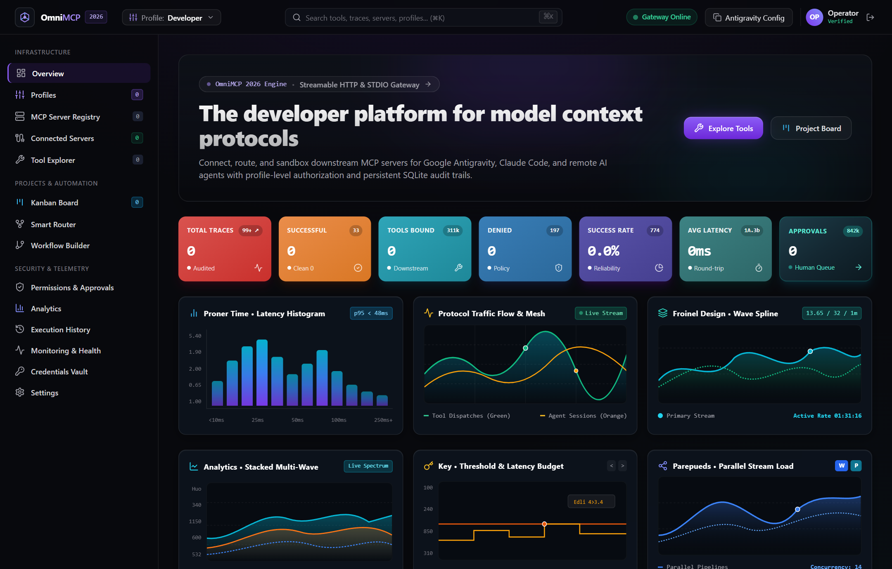
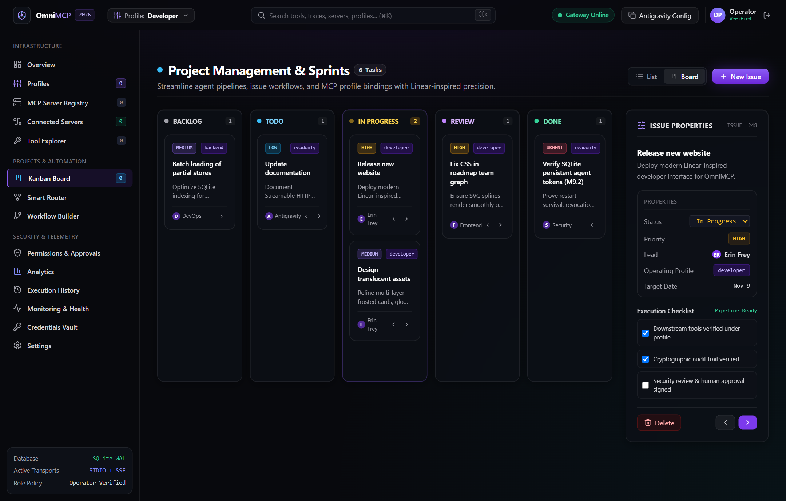
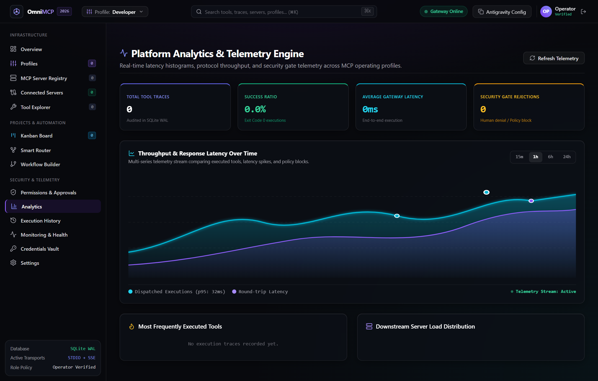
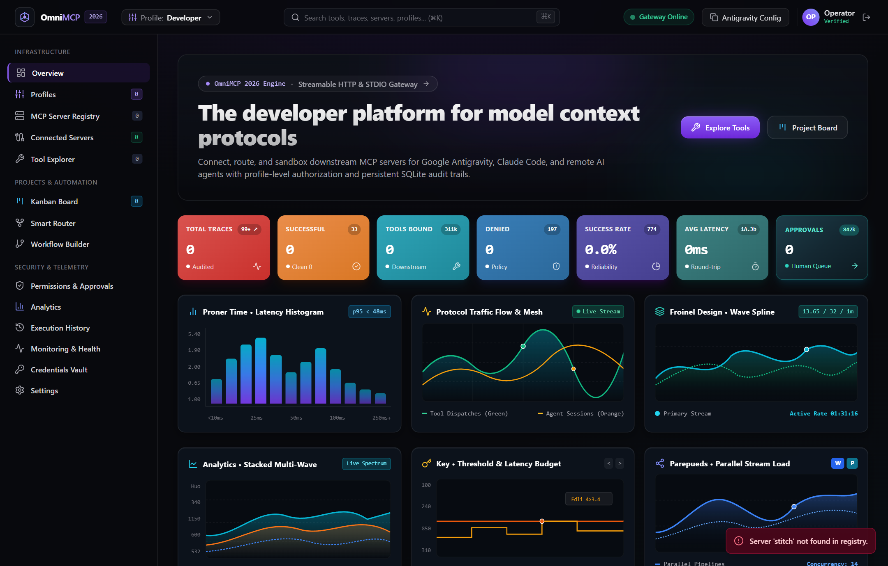
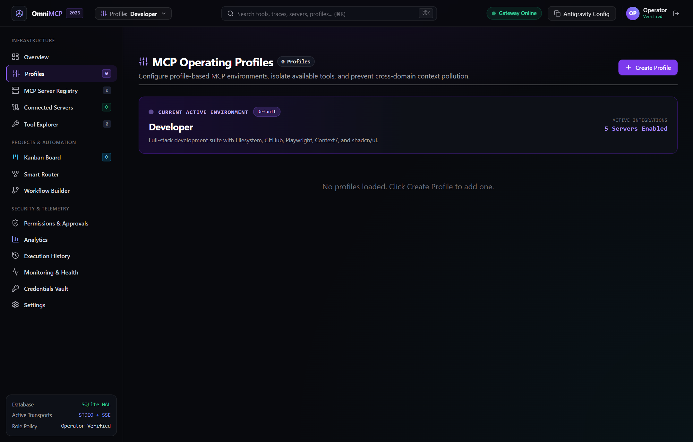

# OmniMCP

> An intelligent, security-first Model Context Protocol (MCP) gateway that connects AI coding agents—like Google Antigravity, Claude Code, and Cursor—to downstream tools without bloating your context window or exposing unguarded credentials.

[](https://nodejs.org/)
[](https://www.typescriptlang.org/)
[](https://modelcontextprotocol.io/)
[]()
[](LICENSE)



---

## Table of Contents

1. [What Problem Does OmniMCP Solve?](#1-what-problem-does-omnimcp-solve)
2. [How It Works (Architecture)](#2-how-it-works-architecture)
3. [Quickstart (Zero to Running in 3 Minutes)](#3-quickstart-zero-to-running-in-3-minutes)
4. [Connecting to Google Antigravity](#4-connecting-to-google-antigravity)
   - [Method 1: Local STDIO Connection (Direct & Fast)](#method-1-local-stdio-connection-direct--fast)
   - [Method 2: Remote Streamable HTTP (`/mcp`)](#method-2-remote-streamable-http-mcp)
5. [Connecting to Other Agents (Claude Code, Cursor, Cline)](#5-connecting-to-other-agents-claude-code-cursor-cline)
6. [Downstream Server Fleet (8 Pre-Configured Servers)](#6-downstream-server-fleet-8-pre-configured-servers)
7. [The Linear-Craft Dashboard](#7-the-linear-craft-dashboard)
8. [Operating Profiles & Access Boundaries](#8-operating-profiles--access-boundaries)
9. [Human Approvals & Security Model](#9-human-approvals--security-model)
10. [Docker & Containerized Deployment](#10-docker--containerized-deployment)
11. [Running Tests & Local Verification](#11-running-tests--local-verification)
12. [Environment Configuration Reference](#12-environment-configuration-reference)

---

## 1. What Problem Does OmniMCP Solve?

If you configure an AI coding assistant to talk directly to several MCP servers—say, Filesystem, GitHub, Playwright, Supabase, Sentry, Context7, and Google Stitch—your editor has to dump **all 85+ tool definitions into the model's prompt on every single chat turn**.

That creates three immediate headaches:
1. **Context Window Clog**: Tool schemas easily burn 25% to 40% of your input context before you've even typed your question.
2. **Hallucinations & Misrouting**: Models get overwhelmed by dozens of overlapping parameters, confusing one database or browser command for another.
3. **Zero Safety Rails**: Standard MCP servers give agents direct access to execute destructive operations—like dropping tables or deleting files—without asking for confirmation.

### How OmniMCP Fixes This

Instead of exposing 85 raw tools, OmniMCP sits in the middle as an intelligent gateway. It gives the AI agent **exactly 10 clean meta-routing tools** (`search_servers`, `list_connected_servers`, `get_server_status`, `search_tools`, `get_tool_details`, `connect_server`, `disconnect_server`, `call_tool`, `get_execution_history`, `get_project_context`).

The agent searches for what it needs on demand, gets back only the schema it wants to execute, runs it through OmniMCP's permission-checked executor, and logs the execution history to SQLite.

```
Upstream AI Agent (Antigravity / Claude Code / Cursor)
                     │
                     │  (Sees only 10 meta-routing tools)
                     ▼
          ┌─────────────────────┐
          │       OmniMCP       │ ──► [Web Dashboard at localhost:3000]
          │  Gateway & Guard    │ ──► [SQLite WAL DB: omnimcp.db]
          └─────────────────────┘
                     │
     ┌───────────────┼───────────────┬────────────────┐
     ▼               ▼               ▼                ▼
Filesystem       Playwright      Supabase       Google Stitch
(Subprocess)    (Subprocess)    (Subprocess)    (Remote HTTP)
```

---

## 2. How It Works (Architecture)

OmniMCP separates client communication into two distinct pathways:

- **Upstream Agent Connection**:
  - **Local STDIO**: The agent spawns `node dist/index.js` as a subprocess and speaks standard JSON-RPC over `stdin` and `stdout`. All diagnostic logs are sent strictly to `stderr` so protocol framing never breaks.
  - **Remote Streamable HTTP**: Remote agents connect to `POST /mcp` with an `Authorization: Bearer <token>` header, adhering to the MCP 2025-11-25 streamable HTTP specification with isolated sessions.
- **Downstream Tool Fleet**:
  - Spawns local tools (like Filesystem or Playwright) as isolated subprocesses with clean, sanitized environments.
  - Connects to remote services (like Google Stitch) using spec-compliant HTTP/SSE transports, injecting API keys safely on the server side so your upstream agent never sees sensitive credentials.
- **Operator Web Dashboard**:
  - Runs on port 3000. Lets you view real-time latency graphs, inspect active servers, manage operating profiles, approve high-risk actions, and track tasks on a Kanban board.

---

## 3. Quickstart (Zero to Running in 3 Minutes)

### Prerequisites
- **Node.js**: v20 or v22 LTS ([Node.js downloads](https://nodejs.org/))
- **Git**: Installed and available in your terminal

### Step 1: Clone and Install
```bash
git clone https://github.com/Keshav0459-prog/OmniMCP.git
cd OmniMCP
npm install
```

### Step 2: Configure Environment
Copy the example environment file:
```bash
# On Linux / macOS / Git Bash:
cp .env.example .env

# On Windows PowerShell:
Copy-Item .env.example .env
```

Generate secure random keys for your setup:
```bash
# Vault encryption key (32 bytes hex)
node -e "console.log(require('crypto').randomBytes(32).toString('hex'))"

# Operator token for dashboard access
node -e "console.log(require('crypto').randomBytes(32).toString('hex'))"
```
Paste those values into `.env` under `OMNIMCP_ENCRYPTION_KEY` and `OMNIMCP_OPERATOR_TOKEN`.

### Step 3: Build the Source Code
```bash
npm run build
```

### Step 4: Start the Web Dashboard
```bash
npm start
```
Open **`http://localhost:3000`** in your browser. You'll see the Linear dark dashboard with live telemetry, metric tiles, and downstream server statuses.

---

## 4. Connecting to Google Antigravity

Antigravity can connect to OmniMCP in two ways: local STDIO (easiest for local development) or remote Streamable HTTP (best for containers, VMs, or hosted gateways).

### Method 1: Local STDIO Connection (Direct & Fast)

Add OmniMCP to your Antigravity MCP configuration file (typically located at `~/.gemini/antigravity/mcp_config.json` or your project workspace settings):

```json
{
  "mcpServers": {
    "omnimcp": {
      "command": "node",
      "args": ["C:/OmniMCP/dist/index.js"],
      "env": {
        "NODE_ENV": "development",
        "ALLOWED_DIRECTORIES": "C:/OmniMCP"
      }
    }
  }
}
```
*(Replace `C:/OmniMCP` with your actual project path. Use forward slashes `/` even on Windows).*

Once connected:
1. Antigravity will discover OmniMCP's 10 core routing tools automatically.
2. In chat, you can prompt: `"Search OmniMCP for filesystem tools and read package.json"`.
3. OmniMCP will dynamically discover the filesystem tools, route the call, and return the result cleanly.

### Method 2: Remote Streamable HTTP (`/mcp`)

If OmniMCP is running as a background service, inside Docker, or on a staging server:

1. Generate a persistent agent token in OmniMCP (via the Dashboard or CLI):
   ```bash
   curl -X POST http://localhost:3000/api/agent-tokens \
     -H "Authorization: Bearer <OMNIMCP_OPERATOR_TOKEN>" \
     -H "Content-Type: application/json" \
     -d '{"principalId": "antigravity-agent", "assignedProfileId": "developer", "name": "Antigravity Main"}'
   ```
   Save the returned `rawToken`.

2. In your Antigravity configuration, point to the streamable HTTP endpoint:
   ```json
   {
     "mcpServers": {
       "omnimcp": {
         "url": "http://localhost:3000/mcp",
         "headers": {
           "Authorization": "Bearer <your-agent-rawToken>"
         }
       }
     }
   }
   ```
3. Each agent session runs in complete isolation with its bound operating profile (`developer`, `readonly`, etc.).

---

## 5. Connecting to Other Agents (Claude Code, Cursor, Cline)

OmniMCP adheres strictly to the official Model Context Protocol specifications, making it compatible with any MCP-compliant client.

### Claude Code (`claude.json`)
```json
{
  "mcpServers": {
    "omnimcp": {
      "command": "node",
      "args": ["/path/to/OmniMCP/dist/index.js"]
    }
  }
}
```

### Cursor (`.cursor/mcp.json`)
```json
{
  "mcpServers": {
    "omnimcp": {
      "command": "node",
      "args": ["/path/to/OmniMCP/dist/index.js"]
    }
  }
}
```

---

## 6. Downstream Server Fleet (8 Pre-Configured Servers)

OmniMCP ships with built-in integrations for 8 popular tools:

| Server ID | Description | Default Transport | Tools Exposed |
| :--- | :--- | :---: | :---: |
| `filesystem` | Local file reading, writing, directory navigation | Local STDIO | 16 tools |
| `playwright` | Headless browser automation, clicks, screenshots | Local STDIO | 25 tools |
| `github` | Repositories, pull requests, issues, commit history | Local STDIO | 26 tools |
| `shadcn` | React component search and UI scaffolding | Local STDIO | 4 tools |
| `supabase` | PostgreSQL schema queries, table inspections, migrations | Local STDIO | 7 tools |
| `sentry` | Production crash diagnostics, error issues, tracing | Local STDIO | 5 tools |
| `context7` | Framework and library documentation search | Local STDIO | 2 tools |
| `stitch` | Google Stitch AI screen generation & design prototyping | Remote HTTP (`stitch.googleapis.com`) | 4 tools |

All downstream server configurations can be toggled on or off instantly per profile, without restarting the gateway.

---

## 7. The Linear-Craft Dashboard

When you open `http://localhost:3000`, OmniMCP delivers an operator interface styled after Linear's dark UI with high-density metrics, reactive SVG waveforms, and sprint boards.

### Real-Time Fleet Overview


- **7 High-Signal KPI Tiles**: Instant visual cards for Active Servers (`8/8`), Tools Indexed (`89+`), Active Profile, Total Traces, Audit Logs, Approval Queue, and Execution Latency.
- **Dual-Layer SVG Telemetry Waveforms**: Real-time traffic and latency visualizers with smooth gradients and responsive micro-animations.

### Interactive Kanban Board
Built-in sprint tracking with drag-and-drop task status updates (`ENG-248` style), checklist progress, and profile assignments.



### Telemetry & Analytics
Deep-dive performance telemetry with latency distributions, tool call frequencies, and security audits.



### Downstream Server Inspector Drawer
Click on any server in the fleet grid (such as Google Stitch, Filesystem, or Supabase) to open a slide-out inspector detailing server health, bound profiles, and full JSON-RPC parameter schemas.



---

## 8. Operating Profiles & Access Boundaries

Not every agent should have unrestricted access to your entire toolchain. OmniMCP introduces **Operating Profiles** stored in SQLite:



1. **`developer` (Default)**: Full access to development tools, code analysis, filesystem writes, and testing utilities.
2. **`readonly`**: Strictly read-only access. Any call attempting to modify files, delete records, or push code is immediately blocked at the gateway before reaching the downstream server.
3. **`qa`**: Pre-configured for test suites, browser automation via Playwright, and error inspections via Sentry.
4. **`backend`**: Focuses on databases (Supabase), cloud services, and documentation search (Context7).
5. **Custom Profiles**: Create and duplicate custom profiles on the fly via the Dashboard or REST API (`POST /api/profiles`).

---

## 9. Human Approvals & Security Model

OmniMCP implements defense-in-depth security to protect your machine from runaway agent actions:

- **Single-Use Approval Tokens**: High-risk actions generate an approval request with a token cryptographically bound to the SHA-256 hash of the exact parameters. If the agent changes the payload after requesting approval, the token is automatically invalidated.
- **Role-Based Token Separation**:
  - `Agent Tokens`: Can only execute tools and query allowed metadata. They can never access administrative profile settings or grant their own approvals.
  - `Operator Tokens`: Used by the human dashboard operator to approve requests, rotate tokens, and configure servers.
- **Secret Redaction**: Every argument, trace output, and error message passes through an automated regex scrubber that masks passwords, bearer tokens, JWTs, Google API keys (`AIza...`), and GitHub PATs.
- **Child Process Isolation**: When spawning downstream servers, OmniMCP wipes the process environment, passing only an explicit whitelist of safe system variables.

---

## 10. Docker & Containerized Deployment

OmniMCP includes a production-ready, multi-stage `Dockerfile` based on Node.js 22 Alpine:

### Run with Docker Compose
```bash
# 1. Start the container in background
docker compose up -d

# 2. Check health status
curl http://localhost:3000/health
```

### Dockerfile Highlights
- **Non-Root Execution**: Runs under UID `1000` (`node`) for container security.
- **Persistent Volume Mount**: Mounts `/app/data` to keep SQLite database files (`omnimcp.db`) persistent across restarts.
- **Dynamic Port Routing**: Automatically binds to `$PORT` (compatible with platforms like Voroa, Render, or Railway).

---

## 11. Running Tests & Local Verification

The codebase includes comprehensive test suites covering unit logic, integration flows, and end-to-end STDIO communications:

```bash
# Run TypeScript compilation and type-check
npm run build

# Run Vitest test suite (193 tests: HTTP gateway, security, Stitch, tokens, approvals)
npm test

# Run Node test runner (20 tests: SQLite profile persistence & Kanban engine)
npm run test:node
```

**Total automated test count: 213 passing tests.**

---

## 12. Environment Configuration Reference

| Environment Variable | Required | Default | Purpose |
| :--- | :---: | :---: | :--- |
| `NODE_ENV` | Optional | `development` | Environment mode (`development` or `production`) |
| `PORT` | Optional | `3000` | Port for web dashboard and REST API |
| `OMNIMCP_ENCRYPTION_KEY` | **Required** in Prod | *(auto-generated)* | 64-char hex key used to encrypt sensitive configuration |
| `OMNIMCP_OPERATOR_TOKEN` | **Required** in Prod | *(auto-generated)* | Bearer token for Operator Dashboard authentication |
| `SQLITE_DB_PATH` | Optional | `./data/omnimcp.db` | File path for persistent SQLite database |
| `ALLOWED_DIRECTORIES` | Optional | Current Directory | Root folder boundary for Filesystem MCP tools |
| `STITCH_API_KEY` | Optional | — | API key for Google Stitch remote MCP integration |
| `STITCH_TIMEOUT_MS` | Optional | `120000` | Timeout in milliseconds for Stitch design generations |
| `GITHUB_PERSONAL_ACCESS_TOKEN`| Optional | — | GitHub token for repository inspection tools |
| `SUPABASE_URL` | Optional | — | Supabase project URL |
| `SUPABASE_SERVICE_ROLE_KEY` | Optional | — | Supabase service role secret |
| `SENTRY_AUTH_TOKEN` | Optional | — | Sentry observability auth token |
| `CONTEXT7_API_KEY` | Optional | — | Context7 documentation search API key |

---

## License

MIT © [Keshav](https://github.com/Keshav0459-prog)
